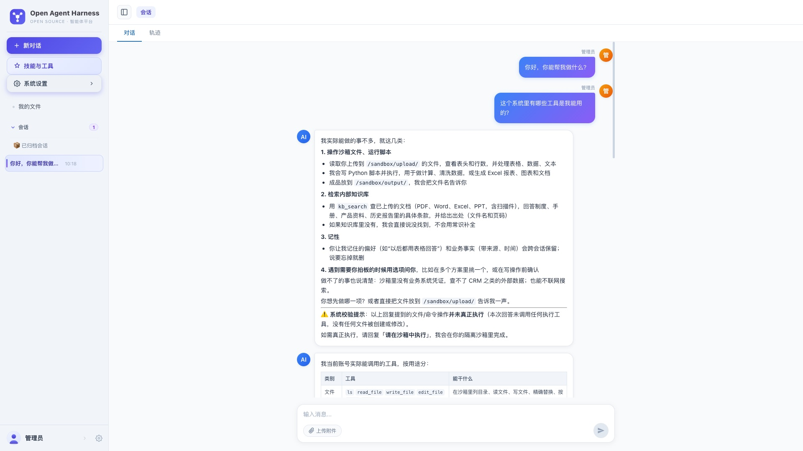
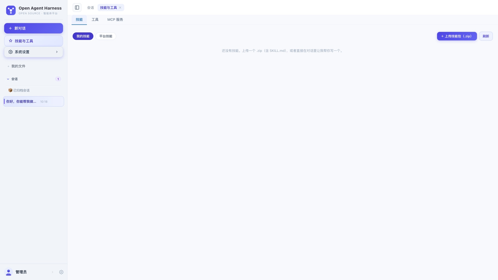
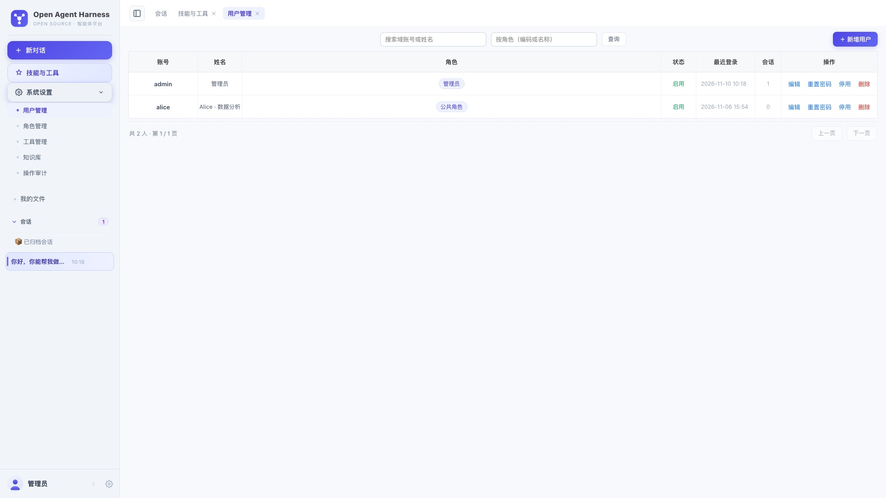
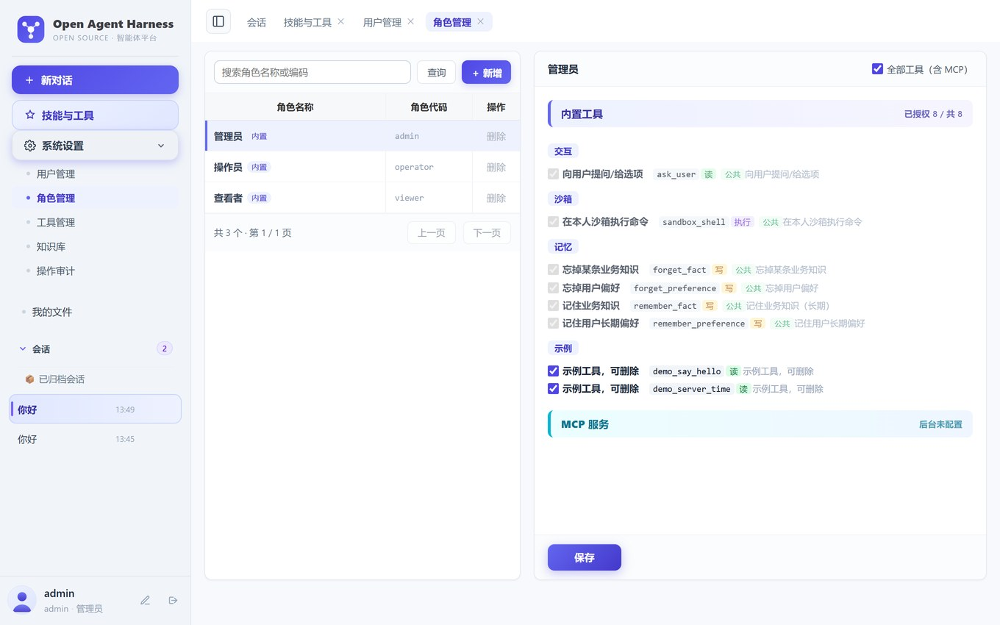
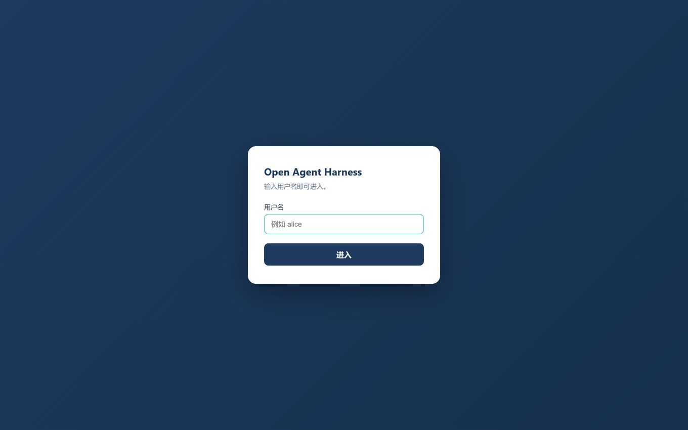

# Open Agent Harness

> 一个能把活干完的智能体平台：对话为入口，工具为手脚，沙箱为工作台，权限为围栏。

不是"又一个 ChatGPT 套壳"。它解决的是四件事：

| 问题 | 平台的做法 |
|---|---|
| 模型只会说不会做 | 每个用户一个隔离沙箱，能在里面读写文件、跑 Python、生成报表 |
| 给了手就不敢放权 | 工具**按角色装配**：没权限的工具根本不进模型清单，越权在物理上不可能 |
| 经验沉淀不下来 | 技能（SKILL.md）可上传、可停用、**可发布到平台供全员复用** |
| 出了问题没法复盘 | 每次工具调用都有轨迹，管理操作另有审计日志 |

## 核心能力

- **流式对话**：SSE 逐字输出，支持中断恢复（LangGraph checkpointer 落 PostgreSQL）
- **工具装配**：内置工具 + 插件工具 + 外部 MCP 服务，按角色过滤后交给模型
- **沙箱执行**：OpenShell 容器隔离；闲置只停机不删文件，用户不存在才回收
- **二级技能**：我的技能（沙箱内）/ 平台技能（全员可见、一键添加副本）
- **文档知识库**：上传 PDF / Word / Excel / PPT，自动解析切分建索引（pgvector + 本地嵌入模型），
  向量 + 关键词混合检索；扫描件走 OCR。文档不出内网
- **长短期记忆**：用户偏好与业务知识跨会话保留，可查询、可删除
- **可观测**：轨迹（模型做了什么）+ 审计（人做了什么），两类记录分开存

## 界面



| 技能与工具 | 用户管理 |
|---|---|
|  |  |

| 角色与工具授权 | 登录页 |
|---|---|
|  |  |

> 截图来自真实运行实例（`openshell_enabled=false` 的最小可运行模式）。

## 快速开始

### 生产 / 单机部署（一条命令）

```bash
# 1. 先建库（只需一次）
#    业务库 MySQL（必需）+ 会话状态 PostgreSQL（必需：连不上服务起不来）
mysql -uroot -p -e "CREATE DATABASE open_agent_harness DEFAULT CHARSET utf8mb4;
  CREATE USER 'agent'@'%' IDENTIFIED BY '你的密码';
  GRANT ALL PRIVILEGES ON open_agent_harness.* TO 'agent'@'%'; FLUSH PRIVILEGES;"
sudo -u postgres psql -c "ALTER USER postgres PASSWORD '你的PG密码';" \
  -c "CREATE DATABASE open_agent_harness;"

# 2. 安装（建 venv、装依赖、构建前端、生成 .env、装 systemd、探活）
sudo PA_DB_MYSQL_PASS='你的密码' PA_AGENT_PG_PASS='你的PG密码' \
     PA_LLM_DEEPSEEK_API_KEY='sk-你的key' \
     USE_CONDA=1 CONDA_PREFIX_DIR="$HOME/miniforge3" CONDA_ENV=oah \
     bash deploy/install.sh

# 3. 建管理员（密码默认 admin，可 --password 指定）
cd /opt/open-agent-harness && PYTHONPATH=. "$HOME/miniforge3/envs/oah/bin/python" \
     deploy/seed_admin.py --password '你的登录密码'
```

装完打开 `http://<服务器IP>:5001/open-agent-harness/`。

脚本幂等，重跑即升级；`APP_DIR` / `PORT` / `SERVICE` 可用环境变量覆盖。

### 本地试跑

```bash
# Python 环境用 Miniforge（部署机为 /home/cuijie/miniforge3/envs/oah），见 docs/Conda环境.md
conda create -y -n oah --override-channels -c conda-forge python=3.12
conda activate oah
pip install -r requirements.txt
export PA_DB_MYSQL_PASS=xxx PA_LLM_DEEPSEEK_API_KEY=sk-xxx
export PA_APP_SECRET_KEY=$(python -c "import secrets;print(secrets.token_hex(32))")
cd frontend && npm ci && npm run build && cd ..
uvicorn src.app_fastapi:app --host 0.0.0.0 --port 5001 --workers 4   # http://localhost:5001/open-agent-harness/
```

首次登录先建管理员：`PYTHONPATH=. "$HOME/miniforge3/envs/oah/bin/python" deploy/seed_admin.py --password '你的密码'`（旧版的免密直登 `/test-login` 已删除）。

**三步部署**（装环境 → 建库初始化 → 登录）见 [`docs/部署说明.md`](docs/部署说明.md)；
日常运维、可选组件（沙箱 / MCP / Redis）、升级、排障见 [`docs/运维与排查.md`](docs/运维与排查.md)。

**架构与设计**（分层、对话链路、工具装配、沙箱、数据模型、降级矩阵）见
[`docs/架构说明.md`](docs/架构说明.md)；

文档知识库（RAG + 扫描件 OCR）见 [`docs/知识库部署说明.md`](docs/知识库部署说明.md)；
偏好 / 规则与口径 / 文档资料三层怎么分工见 [`docs/知识分层说明.md`](docs/知识分层说明.md)。

## 目录结构

```
src/
├── agent/            智能体内核：中间件、工具注册、沙箱后端、MCP 客户端
├── chat/             SSE 流式、上下文注入、产物回传
├── web/              FastAPI 视图层（routers/ 10 个模块 + 会话/鉴权/中间件）
├── infra/            RBAC、缓存、审计、维护任务、异步数据层
├── plugins/tools/    业务插件（自带 demo 示例，照着加自己的工具）
└── app_fastapi.py    应用装配（uvicorn 入口）
frontend/             Vue 3 单页应用
config/               Configs.py + configs.cfg（只放非敏感项，密钥走环境变量）
deploy/               systemd 单元、验收脚本、维护定时器
docs/                 部署说明
```

## 加一个自己的工具

不用改内核，加一个目录即可（详见 `src/plugins/tools/demo/`）：

```
src/plugins/tools/hello/
├── manifest.json   声明工具名、模块、risk(read/write/delete)
├── hello.py        @tool 函数（要有 docstring，模型靠它判断何时调用）
└── __init__.py
```

重启后在「工具管理」里就能看到；再把它分配给某个角色，模型才会拿到它。

## 技术栈

FastAPI · LangGraph 1 · deepagents · LangChain 1 · Vue 3 · MySQL · PostgreSQL（必需）· Redis（可选）· OpenShell（可选）

## 许可证

Apache License 2.0，见 [LICENSE](LICENSE) 与 [NOTICE](NOTICE)。

安全问题请勿公开提 issue，按 [SECURITY.md](SECURITY.md) 的流程反馈。
